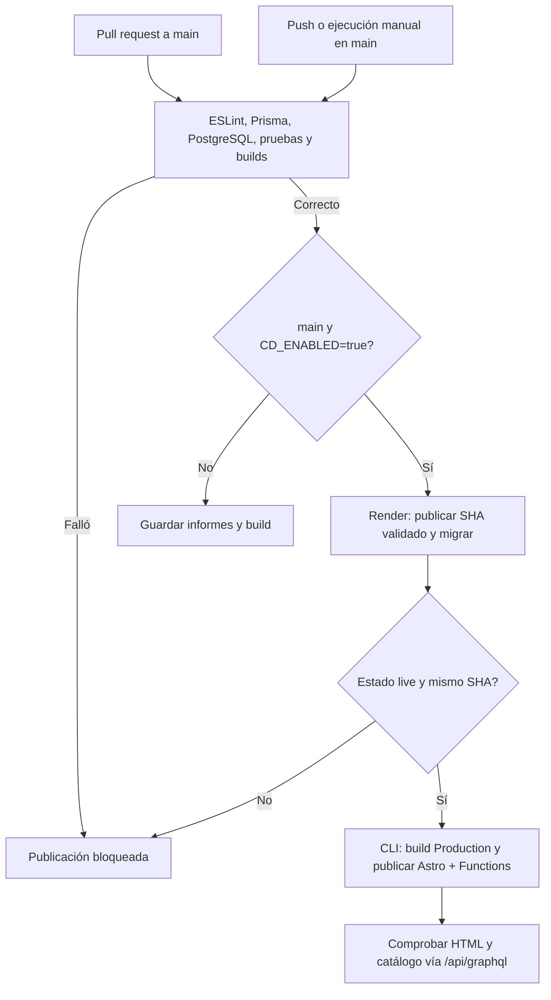

# CI/CD en GitHub Actions, Render y Netlify

El workflow `.github/workflows/ci-cd.yml` usa los servicios de producción existentes.
Se ejecuta en pull requests hacia `main`, pushes a `main` y manualmente desde
**GitHub → Actions → TecnoLeague CI-CD → Run workflow**.

## Qué valida

1. Instala con `npm ci`, valida el esquema y genera Prisma con Node.js 22.
2. Ejecuta ESLint. Los errores bloquean el pipeline.
3. Crea PostgreSQL 16 desechable dentro del runner y aplica todas las migraciones.
   El seed prepara exclusivamente ese catálogo y administrador de prueba.
4. Compila NestJS y ejecuta las pruebas del backend con las tres URLs de base de
   pruebas definidas, de modo que recuperación, Mercado Pago Orders y PayPal no se
   omitan por falta de base. Los proveedores externos se simulan: no se hacen cobros
   ni se envían correos reales.
5. Ejecuta las pruebas React y la integración de WebSocket con NestJS y PostgreSQL.
6. Prueba el script de publicación con respuestas simuladas y construye Astro SSR
   con el adaptador de Netlify y sus Functions.
7. Conserva informes JUnit durante 14 días y el build de validación durante 7 días.
   Se descargan desde el detalle de cada ejecución de Actions.

Las pruebas no reciben secretos de producción, ni siquiera en pull requests de
forks. No se utiliza `pull_request_target`. El token de GitHub solo tiene lectura
del repositorio. El seed nunca se ejecuta sobre la base de producción.

## Activación inicial

Primero configura Render y Netlify; después habilita el despliegue en GitHub.
Hasta entonces CI funciona y el job de publicación aparece como **Skipped**.

### Render: servicio existente del backend

- Conserva el repositorio y la rama `main`, con directorio raíz del repositorio.
- Build Command: `npm ci && npm run db:generate && npm run build -w back`.
- Start Command: `npm run db:migrate && npm run start -w back`.
  Así una migración fallida impide arrancar la versión nueva. Si tu plan admite
  Pre-Deploy Command, puedes mover `npm run db:migrate` a ese paso y dejar solo
  `npm run start -w back` como Start Command.
- Desactiva **Auto-Deploy** del servicio. GitHub Actions iniciará la publicación
  mediante la API después de las pruebas. Mantén las variables de aplicación,
  base de datos y almacenamiento persistente que ya utiliza el backend.
- Obtén el Service ID `srv-...` en los ajustes o la URL del servicio.
- Genera una API key en **Render → Account Settings → API Keys**.

El script envía el SHA validado mediante `commitId`. Espera hasta 20 minutos a que
Render informe `live` y comprueba que el commit publicado coincide con ese SHA.
Si el build, la migración o el arranque falla, Netlify no se publica.

### Netlify: sitio existente del frontend

- El archivo `netlify.toml` establece base `.` (raíz del repositorio), comando
  `npm run build -w front` y publicación `front/dist`. Mantén el filtro
  `--filter @tecnoleague/front` del CLI: selecciona el workspace y permite encontrar
  las Functions generadas por Astro en `front/.netlify/v1/functions`.
- No combines `base = "front"` con ese filtro: Netlify CLI 27.19.0 agrega el
  workspace a la base al localizar las Functions y buscaría en
  `front/front/.netlify/v1/functions`. En ese caso podría publicar los assets
  estáticos y devolver 404 en `/` y `/api/graphql`, que necesitan la Function SSR.
- `ignore = "exit 0"` omite los builds disparados automáticamente por Git. Actions
  ejecuta el build local mediante Netlify CLI y lo publica cuando CI y Render
  terminan correctamente. No pulses **Stop builds**, porque detendría mecanismos
  de publicación que necesitamos mantener disponibles.
- Conserva en Netlify las variables de producción: `BACKEND_GRAPHQL_URL`,
  `AUTH_BRIDGE_SECRET` y las claves públicas de Google/Mercado Pago que uses.
  Deben estar en contexto **Production** y disponibles para **Builds**; las que
  también se leen en ejecución deben tener alcance **Functions**.
- El CLI obtiene las variables del sitio autenticado y utiliza el adaptador Astro
  para empaquetar las Functions. No agregues redirecciones SPA que sustituyan las
  rutas SSR/API.
- Obtén el Project/Site ID en **Project configuration → General → Project details**.
- Genera el token en **User settings → Applications → Personal access tokens**.

La versión del CLI está fijada en el workflow para evitar cambios inesperados.
El frontend de producción se reconstruye desde el mismo checkout validado con las
variables reales de Netlify; el artefacto de CI sirve como evidencia de validación
y contiene valores de prueba, por lo que no se publica directamente en producción.

### GitHub: variables y secretos

En **Settings → Secrets and variables → Actions**, configura estos **Secrets**:

| Secret | Valor |
| --- | --- |
| `RENDER_API_KEY` | API key de Render con acceso al servicio existente. |
| `NETLIFY_AUTH_TOKEN` | Token de Netlify con acceso al sitio existente. |

Configura estas **Variables del repositorio** en la pestaña **Variables**:

| Variable | Valor |
| --- | --- |
| `RENDER_SERVICE_ID` | ID `srv-...` del backend. |
| `NETLIFY_SITE_ID` | ID del proyecto/sitio de Netlify. |
| `PRODUCTION_SITE_URL` | URL HTTPS pública del frontend, por ejemplo `https://tu-sitio.netlify.app`. |
| `CD_ENABLED` | `true`, únicamente después de completar los ajustes anteriores. |

Puedes guardar los secretos en el entorno **production** de GitHub en lugar de
usar secretos del repositorio. Las variables de la tabla deben ser del repositorio:
`CD_ENABLED` se evalúa antes de entrar al entorno de publicación.

No copies `DATABASE_URL`, `JWT_SECRET`, claves de pagos ni claves de Resend a GitHub:
permanecen en Render/Netlify. La base que recibe migraciones de producción es la
configurada en Render; Actions solo migra directamente su PostgreSQL desechable.

## Publicación normal

Las publicaciones de `main` se serializan para que una versión anterior no termine
pisando a una más reciente. Las validaciones obsoletas de pull requests se cancelan.
Las pruebas finales consultan únicamente el catálogo público: no crean pedidos.

Si falla Render, se conserva el frontend anterior. Si falla Netlify o la comprobación
final, Actions marca el job en rojo; el backend puede haber cambiado ya. No es una
transacción entre proveedores y no se revierten automáticamente bases de datos.
Las migraciones de producción deben ser compatibles con la versión que está
sirviendo solicitudes durante la actualización. Revisa especialmente cambios
destructivos y respalda la base y el disco de imágenes.

Para desactivar nuevas publicaciones pon `CD_ENABLED=false`; los servicios ya
publicados siguen funcionando y CI continúa ejecutándose.

## Protección de la rama

En **Settings → Rules → Rulesets** (o Branch protection), protege `main` y exige
el check **Validar, probar y construir** antes de fusionar. Configura revisores
del entorno `production` solo si deseas aprobación manual; no son necesarios para
el despliegue automático solicitado.

Tras activar la configuración, ejecuta una vez el workflow en `main` y revisa
ambos jobs. Crear los archivos no agrega tokens a tus cuentas ni cambia por sí
solo la configuración del servicio Render existente.
